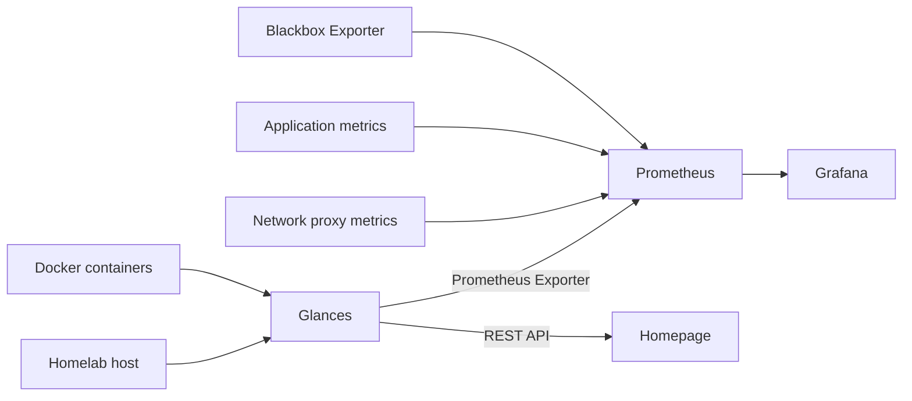

# Monitoring stack

Services used to monitor the homelab host, application endpoints, and selected
DNS/HTTP paths from the homelab server.

## Services

### Glances

Glances collects host metrics such as CPU, memory, filesystem usage, disk I/O,
network activity, and hardware sensors. The monitoring stack runs
Glances Web/API and Prometheus exporter as separate processes.

Glances runs with host PID visibility on the shared `frontend` network so the
other monitoring services can reach it by Docker DNS. Docker socket access is
intentionally disabled: Dockhand remains the dedicated Docker/container
management interface. Blackbox provides the server-to-service DNS and HTTP
timing measurements.

### Prometheus

Prometheus scrapes and stores:

- Glances host metrics
- Caddy metrics
- Dreeve metrics
- Blackbox Exporter metrics
- DNS and HTTP probe results

It's possible to check the health of Prometheus targets at
`prometheus.home.arpa/targets`.

### Grafana

Grafana queries Prometheus and provides the historical dashboards. Its Prometheus
datasource and dashboards are provisioned from `grafana/config/`.

### Blackbox Exporter

Blackbox Exporter performs probes from the homelab server. The initial probes
measure:

- DNS response time for Pi-hole and the local router DNS endpoint
- HTTP response time for selected local services
- DNS, TCP, TLS, and HTTP timing phases where applicable
- Probe success and response status

### Dockhand

Dockhand remains the primary Docker dashboard and container-management tool.
Container resource and lifecycle details are intentionally not duplicated in
Prometheus during the first implementation.

## Data flow

Homepage queries the Glances REST API for current host values, while Grafana
queries the time series stored by Prometheus.

## Startup

It's recommended to start the stacks in this order:

1. `stacks/management`
2. `stacks/monitoring`
3. Other application stacks
